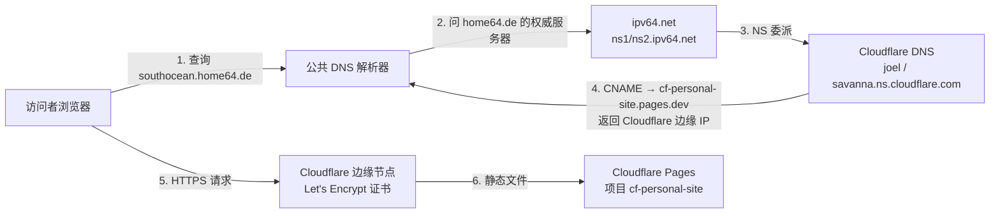
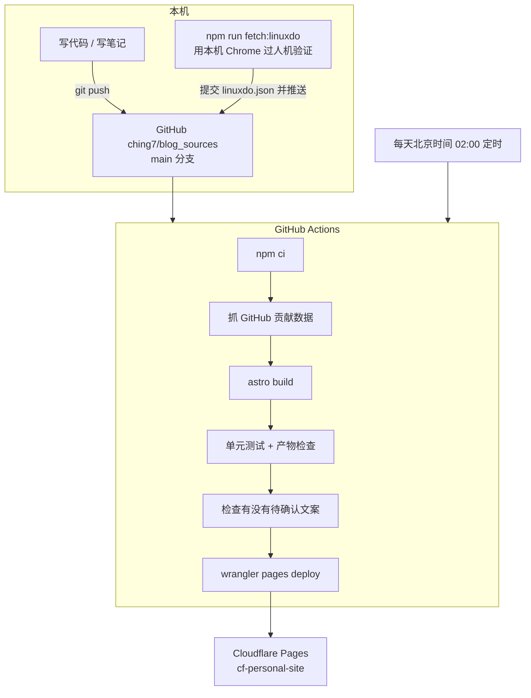

# 一张乱桌子

个人展厅站点：仓库、审美、探索、早年的 Java 笔记，还有一只会打鼓的猫。

- 线上地址：https://southocean.home64.de/
- 备用地址：https://cf-personal-site.pages.dev/
- 首页默认是简约版 `/`，点「弄乱桌面」切到热闹版 `/desk/`
- 早年笔记保留原来的链接 `/posts/...`，索引在 `/notes/`

技术栈：Astro 静态输出、手写 CSS、原生 JS，不用 UI 框架。写作和日常维护见 [WRITING.md](./WRITING.md)。

## 访问链路

1. `home64.de` 在公共后缀列表里，所以 `southocean.home64.de` 可以作为独立域名加进 Cloudflare（Free 套餐）。
2. 域名在 ipv64.net 申请。ipv64 上这个域名只留两条 **NS 记录**，指向 Cloudflare 分配的两台 nameserver，其余解析都交给 Cloudflare。
3. Cloudflare 里只有一条记录：`southocean` CNAME 到 `cf-personal-site.pages.dev`。这条记录是在 Pages 项目里绑定自定义域时自动生成的。
4. HTTPS 证书由 Cloudflare 自动签发和续期。`http://` 访问会 301 跳到 `https://`。
5. 页面全是静态文件，没有自己的服务器，也没有数据库。旧链接的跳转写在 `public/_redirects`，不存在的地址显示 `404.html`。

## 部署架构

- **触发**：push 到 `main`、每天定时一次、手动触发，三种都行。同一时间只保留最新一次部署。
- **活跃度数据**：GitHub 贡献由 CI 每次构建时现抓；抓取失败或数据不完整时，沿用仓库里上次的 `src/data/activity/github.json`，构建照常进行。linux.do 有 Cloudflare 人机验证，CI 抓不了，只能在本机跑脚本更新，再推送触发部署。
- **上线前的检查**：单元测试、构建产物检查（旧链接、资源自托管、不出现个人信息等）、待确认文案检查，任何一项不过都不会部署。
- **密钥**：`CLOUDFLARE_API_TOKEN` 和 `CLOUDFLARE_ACCOUNT_ID` 存在 GitHub 仓库的 Secrets 里。
- **资源**：字体、图片、动态表情全部打包在站内，不依赖外部 CDN。
